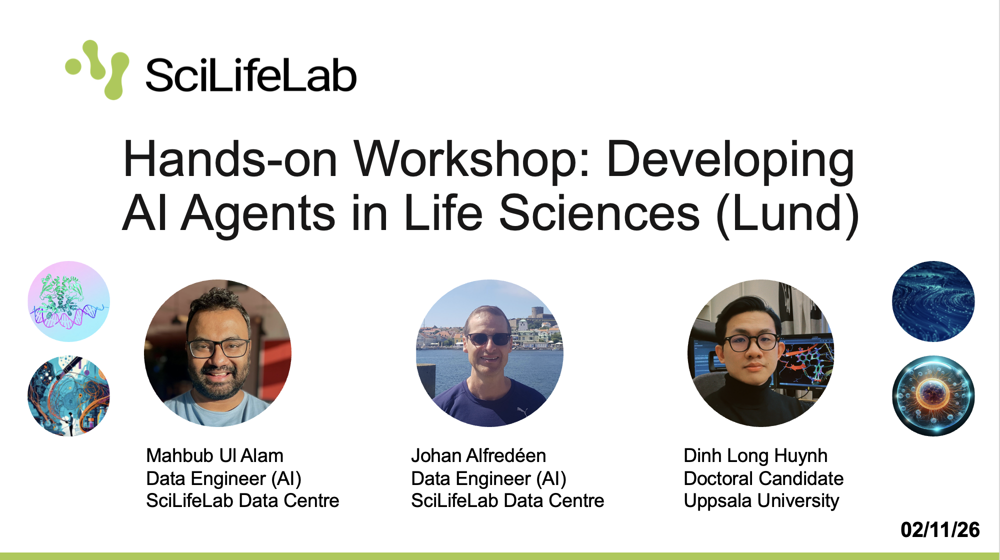

# [Developing AI Agents in Life Sciences (Lund)](https://www.scilifelab.se/event/ai-agents-in-life-science-lund/)

> **SciLifeLab Data Centre** · Room Belfragesalen, BMC D15, Klinikgatan 32, Lund · 2026-11-02

---

<div align="center">
<a href="[https://www.lyyti.in/developing_ai_agents](https://www.scilifelab.se/event/ai-agents-in-life-science-lund/)">

</a>
</div>

## Welcome

We are delighted to invite you to our hands-on workshop on **[Developing AI Agents in Life Sciences](https://www.scilifelab.se/event/ai-agents-in-life-science-lund/)**, organised by [SciLifeLab Data Centre](http://scilifelab.se/data).

AI agents are emerging as autonomous systems that orchestrate scientific workflows by interacting with digital tools and data sources. In life science research, they can simplify complex analyses by automating data integration, run computational models, and coordinate experimental steps, making research pipelines more efficient and reproducible.

In this on-site workshop, held at Room Belfragesalen, BMC D15, Klinikgatan 32 in Lund, we will introduce and discuss AI agents in life science, and engage in collaborative practical sessions.

Welcome!

---

## Speakers & Facilitators

- **Johan Alfredéen (johan.alfredeen@scilifelab.uu.se)**: Data Engineer (AI), SciLifeLab Data Centre
- **Mahbub Ul Alam (mahbub.ul.alam@scilifelab.uu.se)**: Data Engineer (AI), SciLifeLab Data Centre
- **Dinh Long Huynh (dinh-long.huynh@uu.se)**: PhD Candidate, Uppsala University


---

## Event Details

| | |
|---|---|
| **Date** | Monday, 2 November 2026 |
| **Time** | 10:00 to 15:30 *(coffee served from 09:30)* |
| **Location** | Room Belfragesalen, BMC D15, Klinikgatan 32, Lund |
| **Format** | On-site only, no remote participation |
| **Catering** | Fika and lunch provided free of charge |

---

## Target Audience

This workshop is open to **researchers, PhD students, and research infrastructure staff** interested in hands-on experience with AI agents. Participants from any university affiliation, as well as industry researchers, are welcome.

**Prerequisites:**
- Basic Python programming skills
- Familiarity with Jupyter notebooks is helpful
- You must bring your own laptop

---

## What You Will Learn

The workshop will feature a series of engaging presentations, interactive discussions, and collaborative sessions focusing on:

- Introduction to AI agent technologies
- Applications, opportunities, and challenges of AI agents in life science
- Hands-on tutorials with reasoning models, LangGraph, and MCP servers
- Discussions on the role of AI agents in shaping the future of life science

---

## Agenda

| Time | Session |
|---|---|
| 09:30 to 10:00 | Light breakfast and networking |
| 10:00 to 10:15 | **Presentation 1**: Introduction. Exploring how AI agents can transform life sciences. *Johan Alfredéen* |
| 10:15 to 10:30 | **Demonstration**: AI agents in action. *Mahbub Ul Alam* |
| 10:30 to 12:00 | **Hands-on Session 1**: Developing AI agents with LangGraph & ReAct. *Dinh Long Huynh, Mahbub Ul Alam* |
| 12:00 to 13:00 | Lunch and networking |
| 13:00 to 13:30 | **Continuation of Session 1**: LangGraph & ReAct |
| 13:30 to 15:00 | **Hands-on Session 2**: AI agent collaboration with the Model Context Protocol (MCP). *Mahbub Ul Alam, Johan Alfredéen, Dinh Long Huynh* |
| 15:00 to 15:15 | **Presentation 2**: Deploying AI Agents. Legal, technical, and practical considerations. *Johan Alfredéen* |
| 15:15 to 15:30 | Concluding session. Open Q&A |
| 15:30 | Fika and networking |

---

## Download Presentation Slides

**Presentation slides will be here after the workshop**

---

## Workshop Sessions

| Session | Directory | Focus |
|---|---|---|
| **Session 1** | `Section_1_LangGraph/` | Build drug discovery AI agents using LangGraph and the ReAct pattern |
| **Session 2** | `Section_2_MCP/` | Expose those tools over MCP and connect agents across servers |

Each session directory contains its own detailed `README.md` with full instructions.

---

## Getting Started: Docker Setup

All workshop materials run inside Docker containers. **No local Python environment setup is required.**

> ⚠️ **Docker Desktop must be installed and running on your laptop.**

---

### Step 1: Install Docker Desktop

Docker Desktop is the recommended way to run Docker on your personal machine. It includes everything you need: the Docker engine, CLI, and a graphical interface.

#### macOS

1. Go to [https://docs.docker.com/desktop/install/mac-install/](https://docs.docker.com/desktop/install/mac-install/)
2. Choose the installer for your chip:
   - **Apple Silicon (M1/M2/M3/M4)**: download the `Apple Silicon` `.dmg`
   - **Intel**: download the `Intel Chip` `.dmg`
3. Open the downloaded `.dmg` file and drag **Docker** into your Applications folder
4. Launch Docker from Applications and follow the onboarding prompts
5. Verify the installation by opening a terminal and running:
   ```bash
   docker --version
   ```

#### Linux

Docker Desktop is available for Ubuntu, Debian, and Fedora.

1. Go to [https://docs.docker.com/desktop/install/linux-install/](https://docs.docker.com/desktop/install/linux-install/) and select your distribution
2. Follow the distribution-specific instructions (typically adding the Docker apt/rpm repository and installing the package)
3. After installation, start Docker Desktop from your application launcher
4. Verify:
   ```bash
   docker --version
   ```

> Alternatively, you can install **Docker Engine** directly (without the Desktop GUI) by following [https://docs.docker.com/engine/install/](https://docs.docker.com/engine/install/). This is sufficient for running workshop containers.

#### Windows

1. Go to [https://docs.docker.com/desktop/install/windows-install/](https://docs.docker.com/desktop/install/windows-install/)
2. Download the **Docker Desktop Installer**
3. Run the installer. When prompted, ensure **"Use WSL 2 instead of Hyper-V"** is selected (recommended)
4. After installation, Docker Desktop will start automatically
5. Open **PowerShell** or **Command Prompt** and verify:
   ```cmd
   docker --version
   ```

> **WSL 2 note:** Docker on Windows works best with WSL 2 (Windows Subsystem for Linux 2). If it is not already enabled, Docker Desktop will guide you through enabling it during setup. More information at [https://learn.microsoft.com/en-us/windows/wsl/install](https://learn.microsoft.com/en-us/windows/wsl/install).

---

### Step 2: Ensure your API key is ready (on the day of the workshop)

You will be registered as a user in our SciLifeLab OpenLLM pilot program. Please make sure you have access to the API key. You will **receive instructions by email** on how to obtain it before the workshop.
> ⚠️ Optionally, you can also use your own OpenAI API key (for ChatGPT models) if you have one.

> 🔑 **Do not share this key with others or commit it to any public repository.**

---

### Step 3: Pull and Run the Workshop Image

We strongly recommend pulling the pre-built image. This is the fastest way to get started and is the only setup we will support during the workshop.

> ⚠️ **Pulling pre-built image is the only setup we will support during the workshop due to time constraints.**

**Pull the image:**
```bash
docker pull ghcr.io/scilifelabdatacentre/scilifelab-ai-agent-mcp-workshop-2026-11-02:latest
```

**Run the container**: replace `sk-...` with your Scilifelab Open LLM API key
```bash
docker run -d \
  --name ai-agents-workshop \
  -e OPENLLM_API_KEY="sk-..." \
  -e OPENLLM_BASE_URL="https://openllm.scilifelab.se/api" \
  -e OPENLLM_MODEL="Qwen3-235B-A22B" \
  -e WORKSHOP_LOCAL_NO_AUTH=1 \
  -p 127.0.0.1::7860 \
  -v "$PWD/work:/home/workshop/app/work" \
  ghcr.io/scilifelabdatacentre/scilifelab-ai-agent-mcp-workshop-2026-11-02:latest
```
It will print a string of numbers and letters, meaning it is successful. 

**Now use the following command to get the link**:
```bash
docker port ai-agents-workshop 7860/tcp
```
The command returns the link such as `127.0.0.1:xxxxx`. Open it in your browser. 

**Remember: Your link will be different from this example shown above. Make sure to use the correct link in the browser**.

---

### Step 4 (Optional): Update your `.env` file

If you need to update your API key or change the language model settings, you can create a new `.env` file.

1. Open a **Terminal inside JupyterLab** (not your computer's Terminal).
2. Copy the entire command below.
3. Replace `sk-...` with your own API key.
4. Paste the command into the Terminal and press **Enter**.

```bash
cat > /home/workshop/app/.env <<'EOF'
OPENLLM_API_KEY=sk-...
OPENLLM_BASE_URL=https://openllm.scilifelab.se/api
OPENLLM_MODEL=Qwen3-235B-A22B
OPENLLM_DISABLE_THINKING=1
EOF

chmod 600 /home/workshop/app/.env
```

**A few things to remember:**

- **API key:** Replace `sk-...` with your actual key. Keep this key private.
- **Model:** You can change `OPENLLM_MODEL` if you want to use another supported model.
- **Other providers:** If you want to use a different LLM provider later, you may need to update the API key, URL, and model name accordingly.
- **Existing settings:** This command will **overwrite your current `.env` file**, so only use it if you want to replace the existing settings.

Your new settings are now saved in the `.env` file. You need to restart your notebook kernel for the changes to take effect.

---

For detailed content please refer to the `README.md` inside each session directory.

---

## Questions

This event is organised by SciLifeLab Data Centre. For questions about the workshop content or the SciLifeLab Serve platform, contact us at **[open-llm@scilifelab.se](mailto:open-llm@scilifelab.se)**.
