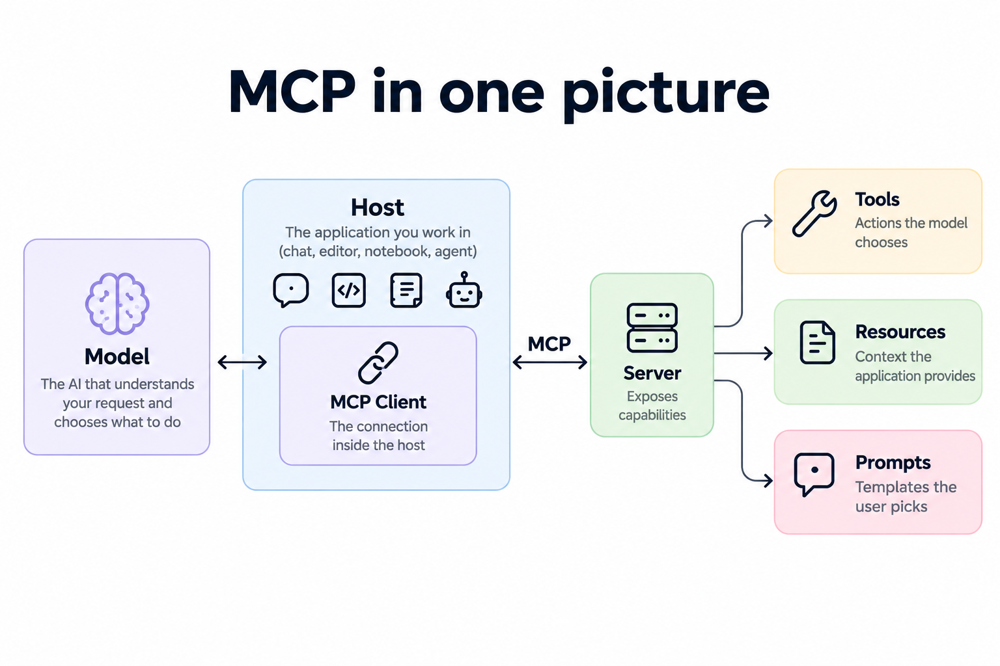
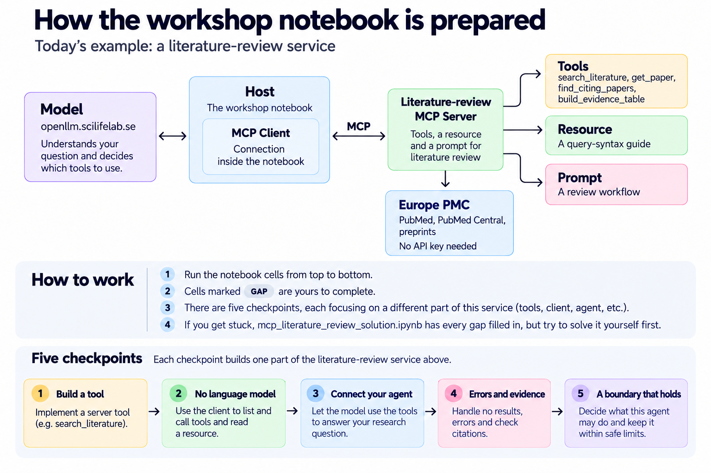

# MCP Literature Review Workshop

Welcome to the **MCP Literature Review Workshop!**

In this hands-on session, you'll learn how to connect scientific literature search tools to an AI agent using the **Model Context Protocol (MCP)**.

We'll use **Europe PMC** to search for scientific publications and **SciLifeLab OpenLLM** to access language models.

The workshop is designed for researchers. **You don't need to be an experienced programmer to follow along.**

  

## What will you learn?

During the workshop, you'll explore how to:

1. **Create a scientific tool:** Make literature searches available through an MCP server.
2. **Test your tool:** Check that it works without an AI model.
3. **Connect your AI agent:** Give the agent access to scientific literature.
4. **Check the results:** Identify errors and verify that the agent cites real papers.
5. **Make it safer:** Control which tools the agent is allowed to use.

You'll also get a chance to try these tools with your own research questions.

## Getting started

The main workshop takes place in a Jupyter Notebook.

**Step 1: Open the notebook**

Open:

`1-mcp-hands-on/mcp_literature_review_lab.ipynb`

**Step 2: Follow along**

Run the cells one by one, from top to bottom.

Read the short explanations and observe what happens.

**Step 3: Try it yourself**

Some cells are marked **GAP**. These are small exercises where you can complete the missing code.

You can also enter your own research question and literature search query, or leave them empty to use the workshop examples.

**Step 4: Need help?**

If you get stuck, don't worry! A completed version of the notebook is available here:

`1-mcp-hands-on/mcp_literature_review_solution.ipynb`

You can use it to check your answers or continue with the workshop.

## Want to explore more?

Once you've completed the main notebook, you can try the optional bonus exercise:

`2-bonus-ask-the-user/`

This example shows how an MCP tool can ask you questions, such as how many papers to include in a literature review, before continuing.

## A few useful things to know

- The MCP server (`server.py`) is already provided. You don't need to build everything from scratch.
- Europe PMC is free to search and doesn't require an API key.
- The workshop uses SciLifeLab OpenLLM for access to language models.

## Remember

**The goal is to learn by doing, not to understand every line of code.**

For now, focus on running the notebook, experimenting with the examples, and seeing what MCP makes possible.

You can always return to the technical details later.

**Enjoy the workshop!**